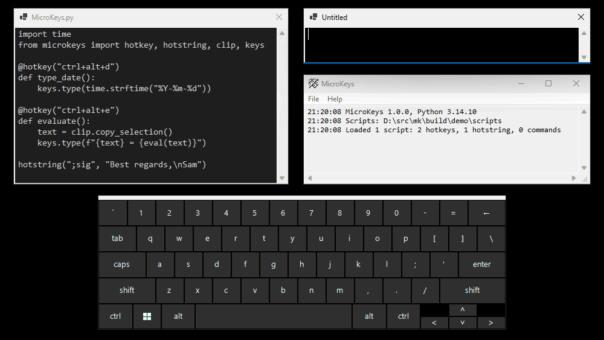

# MicroKeys



MicroKeys runs Python functions when you press a hotkey or a mouse button, type a bit of text, on a timer, when a window opens or the clipboard changes, or when another machine sends a message.  Macros are ordinary Python 3.14 scripts with the full standard library and packages from PyPI, so they can do anything Python can: rewrite the selected text, arrange windows, click a button found on screen or in a dialog, click a link by what it says, look something up, or type out a reply.

```python
import time
from microkeys import hotkey, hotstring, clip, keys

@hotkey("ctrl+alt+d")
def type_date():
    keys.type(time.strftime("%Y-%m-%d"))

@hotkey("ctrl+alt+e")
def evaluate():
    text = clip.copy_selection()
    keys.type(f"{text} = {eval(text)}")

hotstring(";sig", "Best regards,\nSam")
```

The example above is what the GIF shows: a formula is selected, Ctrl+Alt+E is pressed, and MicroKeys types out the answer.

## Using it

Download the latest release, unzip it into a folder you can write to (such as `%LOCALAPPDATA%\MicroKeys`), and run `MicroKeys.exe`.  It lives in the notification area; scripts go in `Documents\MicroKeys`, and reload whenever you save them.

- [Guide](docs/guide.md): scripts, hotkeys, hotstrings, remapping, commands, the screen, controls, messages, settings
- [Cookbook](docs/cookbook.md): macros to copy and adapt
- The API reference is built from the package's docstrings and ships in each release (`docs\api.html`, or **Documentation** in the tray menu)

MicroKeys runs on Windows 10 and 11, x64 and ARM64.

## Building

You need Visual Studio 2022 with the C++ desktop workload (plus the ARM64 build tools for an ARM64 build), CMake 3.21 or later, and Python 3 on the path.  The build downloads the pinned CPython it embeds (see `tools/python_version.json`) and checks its hashes.

```
cmake -S . -B build\x64 -G "Visual Studio 17 2022" -A x64
cmake --build build\x64 --config Release
```

The result is laid out the way a release unpacks, in `build\x64\stage\Release\MicroKeys`.  Use `-A ARM64` and `build\arm64` for ARM64.

Tests:

- `ctest --test-dir build\x64 -C Release` runs the core's unit tests.  The core is platform neutral, so these also build and run on Linux and macOS.
- `python -m pytest tests/python` tests the Python package against a fake of the native module, on any OS.
- `python tests\integration\run_integration.py` runs the real app headless against test scripts.  It needs no desktop.  Add `--network` for the checks that install packages from PyPI.
- `python tests\gui\run_gui_tests.py --exe <MicroKeysApp.exe>` drives the app with real keystrokes.  It needs an unlocked desktop, not an SSH session.
- `python tests\gui\run_browser_tests.py --exe <MicroKeysApp.exe>` finds and clicks text in Chrome and Firefox, through accessibility and OCR.  It's kept out of the GUI tests since it needs both browsers installed (`winget install -e --id Google.Chrome` and `Mozilla.Firefox`); it skips any that aren't.

`python -m pip install -e python` installs the `microkeys` package from a checkout into another Python, for editors and for trying scripts outside MicroKeys, where each call says what it would have done.

Questions? Feedback? [E-mail me](mailto:scott.seligman@gmail.com).
