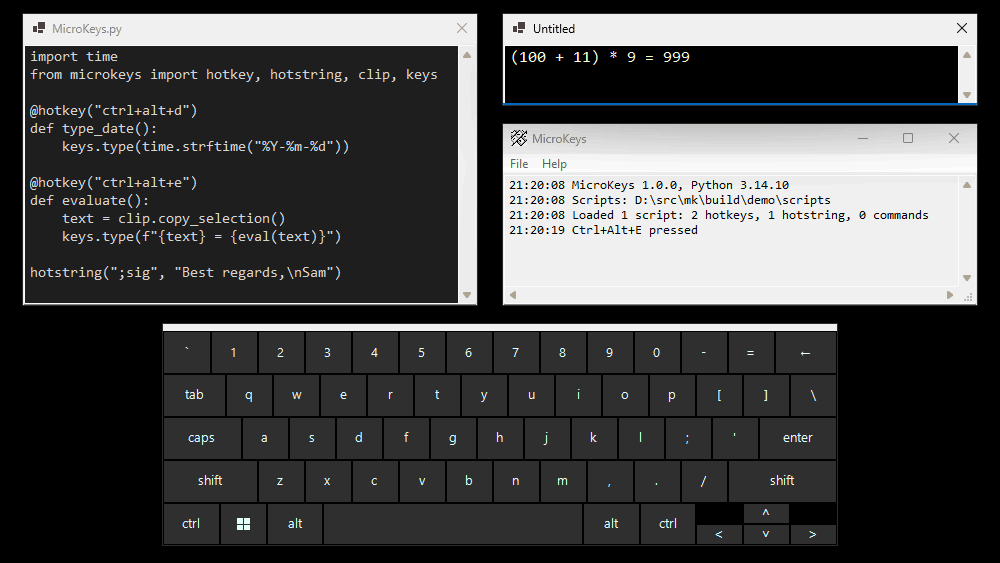

## Script



This is a C# application to present a mock UI to demo how MicroKeys runs.  It presents a couple of text box windows, a keyboard and has a simple script language to run thru pressing keys, showing which keys are pressed on the keyboard, and then showing the actions MicroKeys takes in response in a text window.

The code window shows `demo/MicroKeys.py`, the example from the main README, and the "Run Ctrl+Alt+E script" button types a formula, selects it, and presses the hotkey, while a real copy of MicroKeys does the rest.

`record_demo.py` makes `images/quick_run.gif` from it: it starts MicroKeys with the demo script and throwaway settings, runs this app with `--demo` (which plays the script on its own and then closes), captures that part of the screen, and writes the GIF.  It needs an unlocked desktop, Python with `mss` and `Pillow`, and this app built with `dotnet build -c Release`:

```
python record_demo.py --exe ..\build\x64\stage\Release\MicroKeys\app-1.0.0\MicroKeysApp.exe
```
